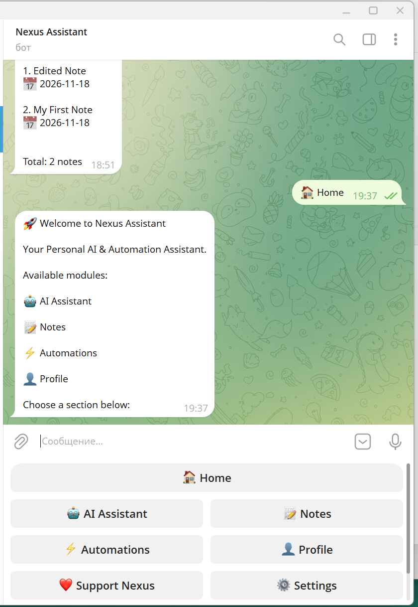
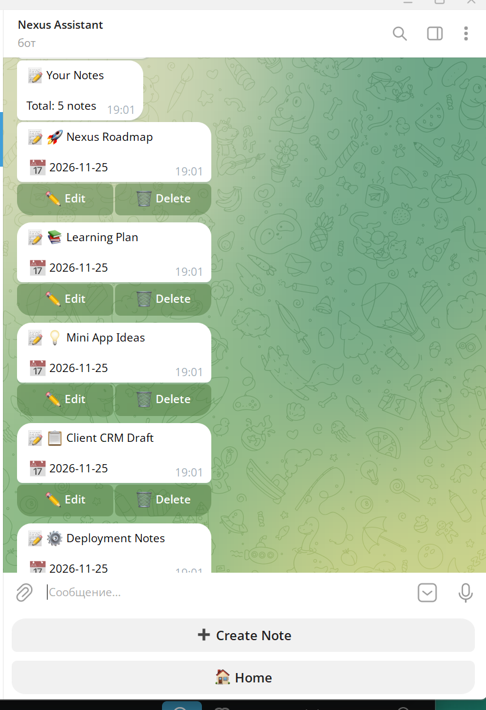
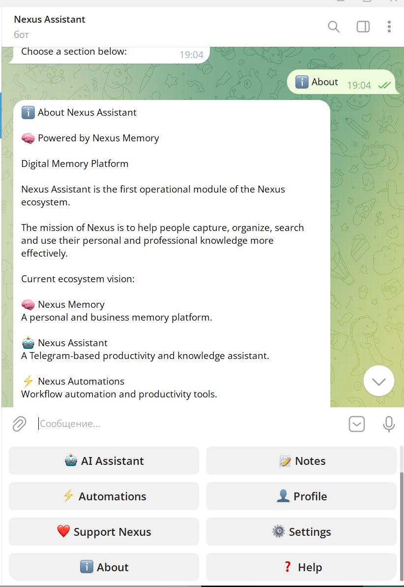
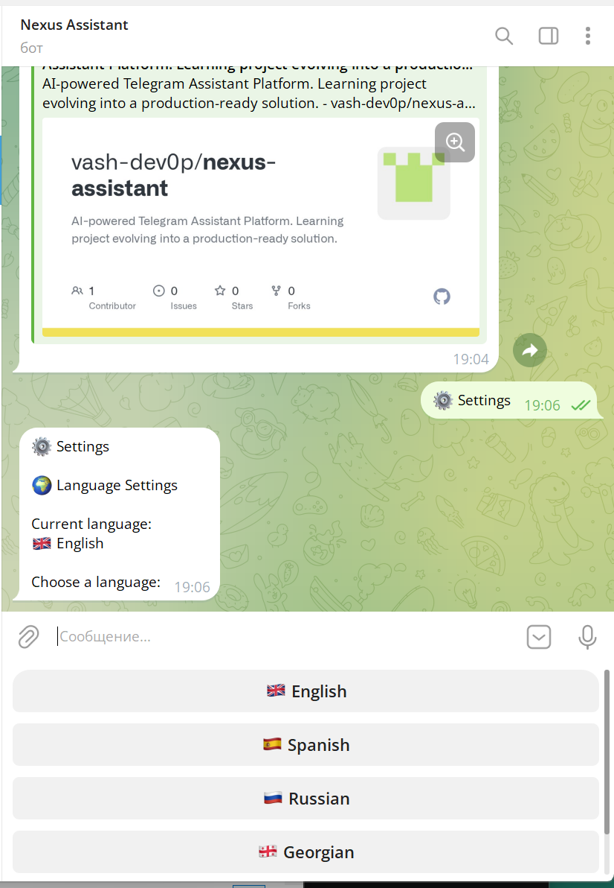

# Nexus Assistant

Personal Memory & AI Assistant inside Telegram

## Status

✅ Online and running in production

✅ Hosted on Northflank

✅ Automatic deployment from GitHub

✅ SQLite persistent storage

✅ Telegram Bot available 24/7

---

## Current Version

### v0.6.0 - Cloud Deployment Release

Release date: 2026-11-23

---

## Tech Stack

- Node.js
- Grammy
- SQLite
- GitHub
- Northflank
- Telegram Bot API

---

## About

Nexus Assistant is a long-term project that evolves from a simple Telegram bot into a complete AI-powered automation platform.

The project is being developed step by step as a public portfolio and product journey.

---

## Vision

Nexus Assistant aims to combine:

- AI Assistance
- Smart Notes
- Business Automations
- Email Integrations
- Document Processing
- Telegram Mini Apps
- Subscription System
- Wallet & Payments
- Future TON Integration

---

## Supported Languages

- 🇬🇧 English
- 🇪🇸 Spanish
- 🇷🇺 Russian
- 🇬🇪 Georgian

---

## Implemented Features

### Core Platform

- Telegram Bot Core
- Navigation System
- Home Navigation
- User Registration System
- User Activity Tracking

### User Management

- User Profiles
- Profile Module
- Language Settings
- User Language Persistence
- Multi-language Support (EN, ES, RU, KA)

### Notes System

- Notes Module
- Create Notes
- View Notes
- Edit Notes
- Delete Notes
- Full CRUD Operations
- Notes Keyboard
- Notes Database Module
- Inline Note Editing
- Inline Note Deletion
- Notes Card Interface
- Hidden Database IDs

### Infrastructure

- SQLite Integration
- Production Cloud Deployment
- GitHub CI/CD
- Automatic Deployment
- Northflank Hosting
- 24/7 Availability

### Additional Modules

- Settings Module
- Help Module

---

## Screenshots

### Main Menu

### Notes Module

### About Nexus

### Language Settings

---

## Version History

### v0.6.0 - Cloud Deployment Release

Release date: 2026-11-23

Features:

- First successful cloud deployment
- Northflank hosting configured
- GitHub CI/CD pipeline configured
- Automatic deployment enabled
- SQLite persistence in production
- Telegram Bot available 24/7
- Notes CRUD validated in cloud
- User Profiles validated in cloud
- Multi-language support validated in cloud
- Hidden note database IDs
- Notes card-based interface
- Inline note editing
- Inline note deletion
- Improved Notes UX
- Deployment documentation added

---

### v0.5.0 - Notes & Database

Release date: 2026-11-21

Features:

- SQLite Notes Storage
- Notes Model
- Notes Repository
- Notes Service
- Create Notes
- View Notes
- Edit Notes
- Delete Notes
- Full CRUD Support
- Notes Keyboard
- Notes UI Improvements

---

### v0.4.2 - Language Settings

Release date: 2026-11-17

Features:

- Language Settings screen added
- Language keyboard implemented
- SQLite language persistence implemented
- User language update support added
- Profile language synchronization implemented
- Settings language synchronization implemented
- Map cache synchronization improved
- First fully functional user preference added

---

### v0.4.1 - UX & Navigation Update

Release date: 2026-11-15

Features:

- Home navigation button added
- Main screen redesigned
- Help section improved
- User onboarding improved
- Start flow improved
- Navigation usability enhanced
- Registration moved to application entry point

---

### v0.3.0 - User Profiles

Release date: 2026-11-13

Features:

- User Model implemented
- User Store implemented
- User Service implemented
- Automatic user creation
- User Profile section upgraded
- Telegram ID support added
- Registration date tracking
- Last activity tracking
- Foundation for subscriptions
- Foundation for NX Credits

---

## Roadmap

### ✅ v0.1.0
Foundation

### ✅ v0.2.0
Navigation System

### ✅ v0.3.0
User Profiles

### ✅ v0.4.0
Language Settings

### ✅ v0.5.0
Notes & Database

### ✅ v0.6.0
Cloud Deployment Release

### 🚧 v0.6.1

UX Polish

- Better Notes synchronization
- Cleaner service messages
- Notes UI refinement
- Chat history cleanup

### 🚧 v0.7.0
Telegram Mini App

### 🔮 v0.8.0
AI Assistant

### 🔮 v0.9.0
Automations

### 🎯 v1.0.0
Nexus Memory Platform

---

## Documentation

- docs/architecture.md
- docs/roadmap.md
- docs/versions.md
- docs/deployment.md

---

## Author

Created and maintained by **vash-dev0p**.